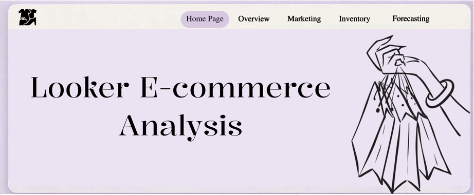
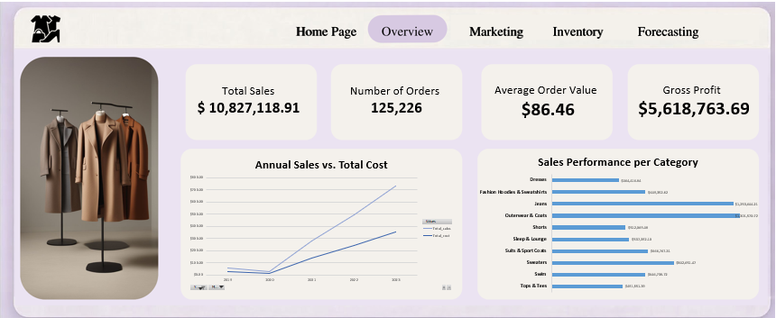
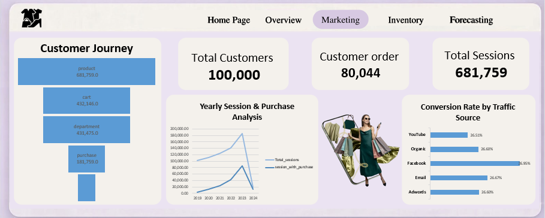
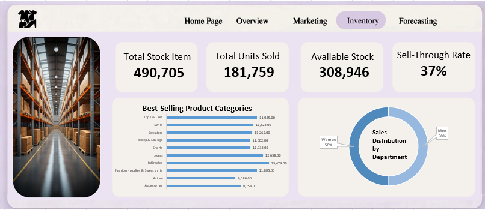
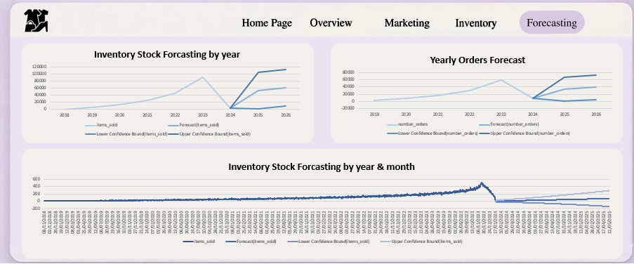

# 📊 Looker E-commerce Analysis & Interactive Dashboard

## 📌 Links & Documentation
📄 **[View Full Insights & Recommendations Document](./Insights_and_Recommendations.pdf)**  
📥 **[Download Full Interactive Excel Dashboard (.xlsx)](https://docs.google.com/spreadsheets/d/18edp5lQYsfjd0u71bO7ppwo3GPHelwgd/edit?usp=sharing&ouid=107594420489309311913&rtpof=true&sd=true)**

---

## 🛠️ Tools & Technologies Used
* **Data Processing & ETL:** Excel (Power Query)
* **Data Modeling & Calculations:** Excel DAX / Data Model
* **UI/UX Design:** Figma
* **Visualization:** Interactive Excel Dashboard

---

## 📂 Dashboard Screenshots

